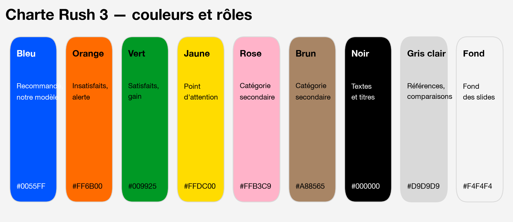
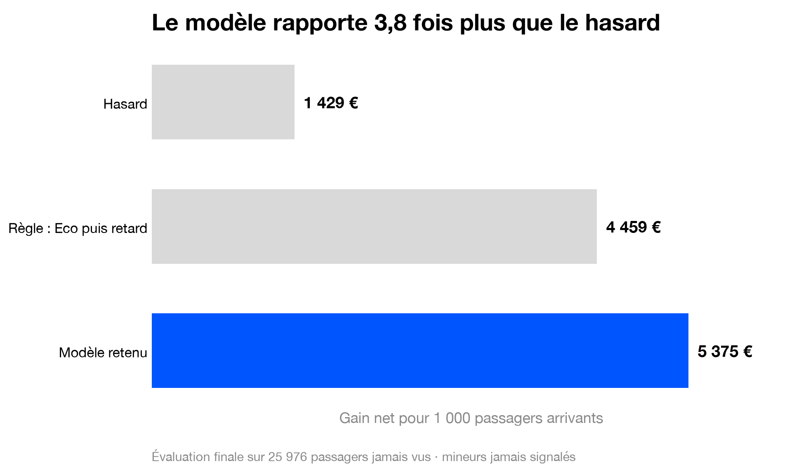

# Charte graphique — Rush 3

Une seule charte pour les **slides**, le **rapport PDF** et les **graphiques des notebooks**, pour que tout le rendu ait la même identité.

Inspiration : signalétique et pictogrammes d'aéroport — fond clair, cartes blanches arrondies, typographie grasse et noire, pastilles de couleurs vives. C'est lisible de loin, sobre, et cohérent avec le sujet (le parcours passager).



---

## 1. Principes

1. **Un message par slide.** Le titre de la slide *est* la conclusion (« Le modèle rapporte 3,8 fois plus que le hasard »), pas le sujet (« Résultats »).
2. **Une couleur = une idée, partout.** Le bleu désigne toujours notre recommandation, l'orange toujours les insatisfaits. La direction n'a pas à réapprendre la légende à chaque slide.
3. **Le gris pour tout le reste.** Ce qui sert de comparaison (hasard, règles simples, options écartées) est en gris clair : l'œil va directement au bleu.
4. **Des chiffres, pas des tableaux.** Un grand chiffre avec une phrase vaut mieux qu'un tableau de 5 colonnes. Les tableaux détaillés vont en annexe du rapport.
5. **Beaucoup de blanc.** Les éléments respirent ; on enlève plutôt qu'on ajoute.

---

## 2. Couleurs

| Couleur | Code | Rôle | Texte posé dessus |
|---|---|---|---|
| **Bleu** | `#0055FF` | notre recommandation, le modèle retenu, la couleur d'accent | blanc |
| **Orange** | `#FF6B00` | insatisfaits, risque, alerte | noir |
| **Vert** | `#009925` | satisfaits, gain, ce qui marche | noir |
| **Jaune** | `#FFDC00` | point d'attention (ex. mineurs) | noir |
| **Rose** | `#FFB3C9` | catégorie secondaire (ex. une classe de voyage) | noir |
| **Brun** | `#A88565` | catégorie secondaire | noir |
| **Noir** | `#000000` | titres, textes, chiffres | blanc |
| **Gris** | `#8A8A8A` | sources, notes de bas de slide | — |
| **Gris clair** | `#D9D9D9` | références et comparaisons, bordures | noir |
| **Fond** | `#F4F4F4` | fond des slides | noir |
| **Blanc** | `#FFFFFF` | cartes, fond des graphiques | noir |

**Lisibilité (contraste mesuré) :**
- Texte **blanc sur bleu** : OK (5,6:1). Texte **noir** sur orange, vert, jaune, rose, brun : OK (plus de 5:1).
- **Jamais de texte orange, jaune ou rose** sur fond blanc ou gris : illisible (moins de 3:1). Ces couleurs servent à remplir des formes, pas à écrire.
- Le texte bleu sur fond blanc est réservé aux grands chiffres (24 pt et plus).
- Ne jamais coder une information **uniquement** par la couleur : toujours une étiquette ou un pictogramme à côté (daltonisme).

**Ordre des couleurs** quand on compare des catégories sans rôle particulier : bleu, orange, vert, brun, rose, jaune.

---

## 3. Typographie

- **Police : [Inter](https://fonts.google.com/specimen/Inter)** (gratuite, Google Fonts). Repli : Helvetica Neue, puis Arial.
- Installation sur Mac : télécharger Inter sur Google Fonts, double-cliquer sur les fichiers `.ttf`, puis *Installer*. Elle sera alors utilisable dans Keynote, PowerPoint, Google Slides et les graphiques Python.

| Usage | Taille (slide 16:9) | Graisse |
|---|---|---|
| Titre de slide (= le message) | 36–44 pt | Bold / Black, interlignage serré |
| Grand chiffre clé | 72–120 pt | Black |
| Sous-titre, légende du chiffre | 20–24 pt | Medium |
| Texte courant | 18–20 pt | Regular |
| Source, note | 12–14 pt | Regular, gris `#8A8A8A` |

- Titres **courts**, sans point final, en minuscules sauf la première lettre.
- Pas plus de **3 tailles** de texte sur une même slide.
- Chiffres à la française : `5 375 €`, `0,94`, `23,7 %` (espace avant €, % et :).

---

## 4. Éléments graphiques

**Cartes.** Rectangle blanc `#FFFFFF` aux coins arrondis (rayon ≈ 24 px), sur fond `#F4F4F4`, sans ombre. Chaque carte contient une idée : un chiffre, une liste courte, un graphique.

**Pastilles.** Rangée de petits ronds de couleur (comme sur l'image de référence), en haut à gauche d'une carte, pour indiquer de quoi elle parle : bleu = modèle, orange = insatisfaits, jaune = attention.

**Pictogrammes.** Style plein et arrondi, blanc ou noir dans une tuile de couleur carrée arrondie ou ronde. Bibliothèque gratuite conseillée : [Material Symbols Rounded](https://fonts.google.com/icons?icon.style=Rounded) (style *Filled*). Exemples utiles : `flight_land`, `person`, `groups`, `child_care`, `euro`, `schedule`, `shield`, `visibility_off`.

**Étiquettes.** Pilule (coins entièrement arrondis) noire avec texte blanc, pour des mots-clés : « Connu à l'atterrissage », « Exclu », « Recommandé ».

---

## 5. Graphiques

Dans un notebook, deux lignes suffisent pour appliquer la charte :

```python
from src.charte import appliquer, COULEURS, ROLES, couleurs_barres
appliquer()
```

Règles :
- **Barres horizontales** pour comparer des options, triées, avec la valeur écrite au bout de chaque barre. On supprime alors l'axe des valeurs.
- **La barre recommandée en bleu, les autres en gris clair** : `color=couleurs_barres(etiquettes, "Modèle retenu")`.
- Insatisfaits en **orange**, satisfaits en **vert** (`ROLES["insatisfait"]`, `ROLES["satisfait"]`).
- **Le titre du graphique est le message**, aligné à gauche, en gras.
- Une ligne de source en gris sous le graphique (« Évaluation finale sur 25 976 passagers… »).
- Pas de 3D, pas de camembert au-delà de 2 parts, pas de légende si une étiquette directe suffit.
- Export : `fig.savefig("../figures/nom.png")` (200 dpi, fond blanc, déjà réglé par la charte).

Exemple produit avec la charte (`python charte/exemples.py`) :



---

## 6. Slides

**Format :** 16:9 (1920 × 1080). Fond `#F4F4F4`. Marges de 80 px. Grille de 12 colonnes.

**Gabarits :**

| Gabarit | Usage | Composition |
|---|---|---|
| **Couverture** | titre de la présentation | grand titre noir à gauche, rangée de pastilles au-dessus, noms du groupe en bas |
| **Message + chiffre** | une conclusion chiffrée | titre en haut ; une carte blanche avec le grand chiffre en bleu et une phrase d'explication |
| **Message + graphique** | une comparaison | titre en haut ; graphique dans une carte blanche, plein largeur ; source en gris |
| **Deux colonnes** | opposer deux idées (utilisé / exclu, avant / après) | deux cartes côte à côte, une pastille de couleur chacune |
| **Trois chiffres** | synthèse | trois cartes, un chiffre + une ligne chacune |
| **Décision** | ce qu'on demande à la direction | fond bleu, texte blanc, 3 décisions numérotées maximum |

**Rythme pour 10 minutes :** 8 à 10 slides, soit environ une minute par slide.

**Pied de slide :** numéro à droite, en gris 12 pt. Pas de logo sur chaque slide.

---

## 7. À éviter

- Du texte orange, jaune ou rose sur fond clair.
- Plus de deux couleurs vives sur une même slide (en plus du noir et des gris).
- Des paragraphes : au-delà de 3 lignes, couper ou passer à l'oral.
- Des captures d'écran de notebook ou de tableau pandas : refaire le graphique avec la charte.
- Des termes techniques à l'écran (« précision », « classe positive », « AUC ») : écrire « sur 100 passagers abordés, 94 sont mécontents ».
